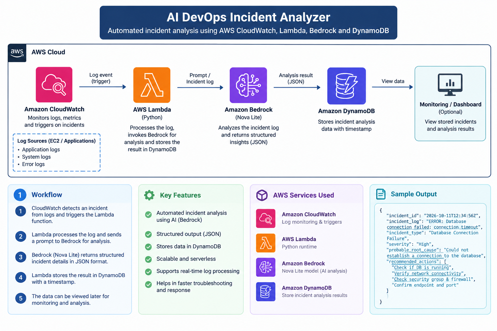

# AI DevOps Incident Analyzer

An AI-powered AWS project that analyzes DevOps incident logs, identifies probable root causes, recommends remediation steps, and stores the results for future reference.

## Architecture

**Workflow:** Application Logs → Amazon CloudWatch → AWS Lambda → Amazon Bedrock (Nova Lite) → Amazon DynamoDB

## Tech Stack

- **AWS Lambda** — Python-based incident processing
- **Amazon Bedrock (Nova Lite)** — AI-powered log analysis
- **Amazon DynamoDB** — Incident analysis storage
- **Amazon CloudWatch** — Log monitoring
- **Python and Boto3** — AWS integration

## Features

- Generates sample application logs.
- Analyzes incident logs using Amazon Bedrock.
- Identifies incident type and severity.
- Suggests probable root causes and remediation actions.
- Stores analysis results in DynamoDB with timestamps.

## Sample Incidents

- Database connection timeout
- High CPU utilization

## Sample Output

The analyzer returns structured JSON containing:

- Incident type
- Severity
- Probable root cause
- Recommended actions

## Current Project Status

The Lambda function successfully analyzes incident logs using Amazon Bedrock and saves the results in DynamoDB.

**Note:** Automated CloudWatch-to-Lambda triggering is still being configured.

## Security

- Never commit AWS access keys, credentials, tokens, or other secrets.
- Use IAM roles and least-privilege permissions for AWS access.
- Avoid publishing sensitive application logs.
